<!-- Animated assets are generated by scripts/build_assets.py — edit there, not in the SVGs. -->

  

  
  
  

### `>_ status`

### `>_ cat stack.txt`

  

  <code>langchain</code> · <code>langgraph</code> · <code>chroma</code> · <code>mcp</code> · <code>openai</code> · <code>cohere</code>

### `>_ git log --graph`

<picture>
  <source media="(prefers-color-scheme: dark)" srcset="https://raw.githubusercontent.com/ZehnaAnas/ZehnaAnas/output/snake-dark.svg" />
  <source media="(prefers-color-scheme: light)" srcset="https://raw.githubusercontent.com/ZehnaAnas/ZehnaAnas/output/snake-light.svg" />
  
</picture>

### `>_ tmux attach -t playground`

